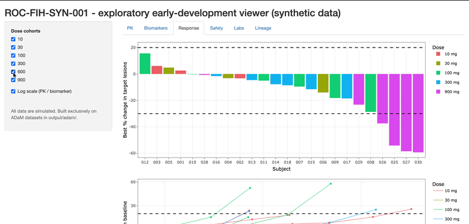

# Phase I First-in-Human Exploratory Analysis Pipeline (R)


Dashboard demo gif: 



Click the thumbnail below 👇 for full dashboard walkthrough!

[](https://youtu.be/m8AaQ7fdGZQ)

An end-to-end, **traceable and independently quality-controlled** analysis pipeline for a *synthetic* first-in-human dose-escalation oncology study: raw SDTM-like data -\> ADaM-style analysis datasets -\> exploratory outputs -\> interactive viewer, driven by a mock SAP and a variable-level specification.

> **All data are simulated.** No real patient data. Nothing here is a clinical conclusion.

**Author:** Kirti Purkayastha

## Run it
R 4.3+
``` bash
Rscript -e 'install.packages(c("dplyr","tidyr","purrr","tibble","ggplot2","plotly","shiny","testthat","yaml","jsonlite","scales"))'
Rscript run_pipeline.R --regen     # simulate raw data, build ADaM, QC, outputs (about 10 s)
Rscript tests/testthat.R           # 40 tests, including seeded-error detection
Rscript -e 'shiny::runApp("app")'  # interactive exploration layer
# or: docker build -t fih . && docker run --rm -v "$PWD/output:/project/output" fih
```

The pipeline **exits non-zero** if any independent-QC comparison or integrity check fails, so CI blocks bad output (`.github/workflows/ci.yml`).

## What it demonstrates

| Capability typical of an early-development ADS programmer role | Where |
|------------------------------------|------------------------------------|
| Code to a SAP and programming conventions | `docs/mock_SAP.md` (sections cited in code and spec) |
| Custom / non-standard data structures for exploratory endpoints | `ADBM` (nested-JSON biomarker assays flattened), `ADPP` (NCA parameters), `ADTR`/`ADRS` (tumour response) |
| Structured **and semi-structured** data | CSV domains plus JSON-lines biomarker file (`R/04_adbm_adtr_adrs.R::read_bm`) |
| Evolving endpoints / protocol amendment | ctDNA added mid-study: subjects dosed earlier have no baseline; handled by design, flagged (`BASEAVL`), excluded from change-from-baseline, tested |
| Data traceability and metadata documentation | `spec/adam_spec.psv` (164 lines: label, type, source, derivation per variable) enforced at write time (`apply_spec`); source variables carried (`LBORRES`, `PCORRES`) |
| Quality control and audit readiness | independent double programming (`R/qc/`) with PROC COMPARE-style report; 62 integrity checks; run log, session info and MD5 manifest of every file |
| Resolving technical issues by structured checks | real-world defects built into the data and handled: mixed Hgb units across sites, BLQ strings (`<50`), not-done samples, partial AE dates, staggered cohorts, ongoing subjects at data cut |
| Visualization | ggplot2 (PK, dose proportionality, swimmer, waterfall, biomarker), plotly + Shiny viewer |
| Reproducible workflows | modular numbered scripts, config-driven parameters (`config/study_config.yml`), seeded simulation (deterministic, tested), Git, CI, Dockerfile |
| Early-phase design awareness | dose escalation cohorts, DLT window/evaluability, PK/PD, dose proportionality, unconfirmed best response |

## Layout

```         
config/   study parameters (no hard-coded thresholds in code)
spec/     adam_spec.psv - variable-level ADaM specification
docs/     mock_SAP.md, SAS_equivalents.md
R/        00_utils  01_simulate_raw  02_adsl_adae  03_adlb_adpc_adpp  04_adbm_adtr_adrs
          05_qc_compare  06_checks  07_outputs  08_report      R/qc/qc_programs.R (independent QC)
tests/    testthat unit + integration tests
app/      Shiny exploration viewer (reads only ADaM)
output/   committed example run: adam/ qc/ tables/ figures/ study_summary.md run_manifest.csv
```

## Design decisions worth discussing

- **Two-stage ADSL.** DLT flags need ADAE, ADAE needs ADSL treatment dates, so ADSL is derived in two passes.
- **Production vs QC use different code paths** (dplyr/vectorised vs base-R loops from raw), so a shared bug cannot hide. Tests prove the QC fails when errors are seeded, and show which class of error each layer catches: integrity checks catch inconsistencies; only double programming catches a self-consistent wrong derivation.
- **Missing is not zero.** BLQ, not-done and no-baseline each have distinct, documented handling; NCA parameters that fail lambda_z criteria are reported as not estimable, never imputed.
- **NCA is verified analytically.** A mono-exponential profile must return exact lambda_z, half-life, AUClast, AUCinf and CL.

## Known limitations (stated up front)

- Simulated data: a DLT can occur at the lowest dose by chance, and escalation decisions are not modelled; this is a data generator, not a trial simulator.
- Responses are unconfirmed, target lesions only (no CR). NCA is a transparent teaching implementation; production work uses validated tools.
- Not CDISC-certified: ADaM-*style*, no define.xml or Pinnacle 21 run. A natural extension.
- Package versions are pinned through the Dockerfile and recorded in `output/session_info.txt`; an `renv.lock` is not committed.

See `docs/SAS_equivalents.md` for the SAS mapping of each component.
