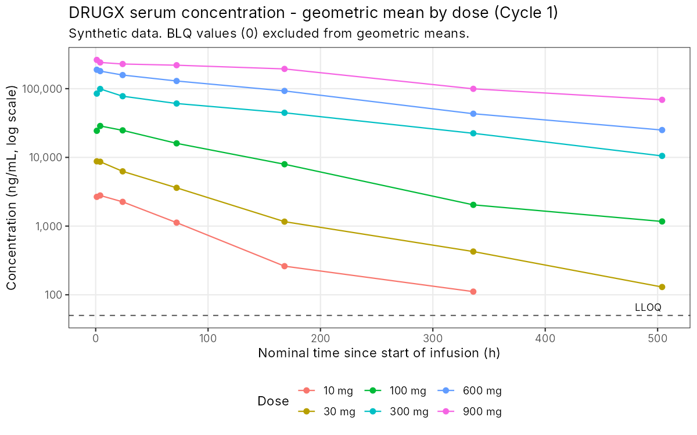
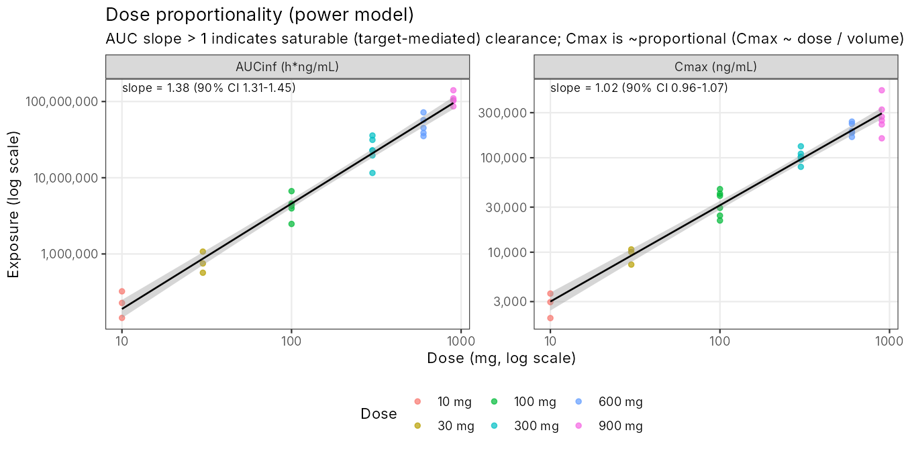
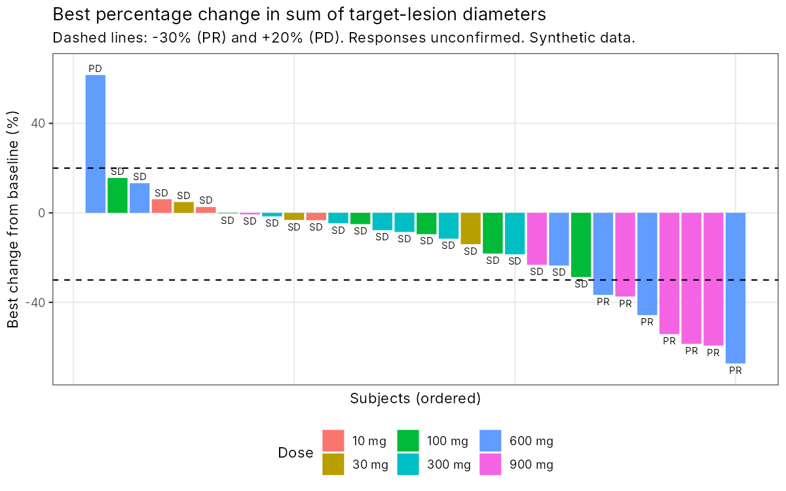
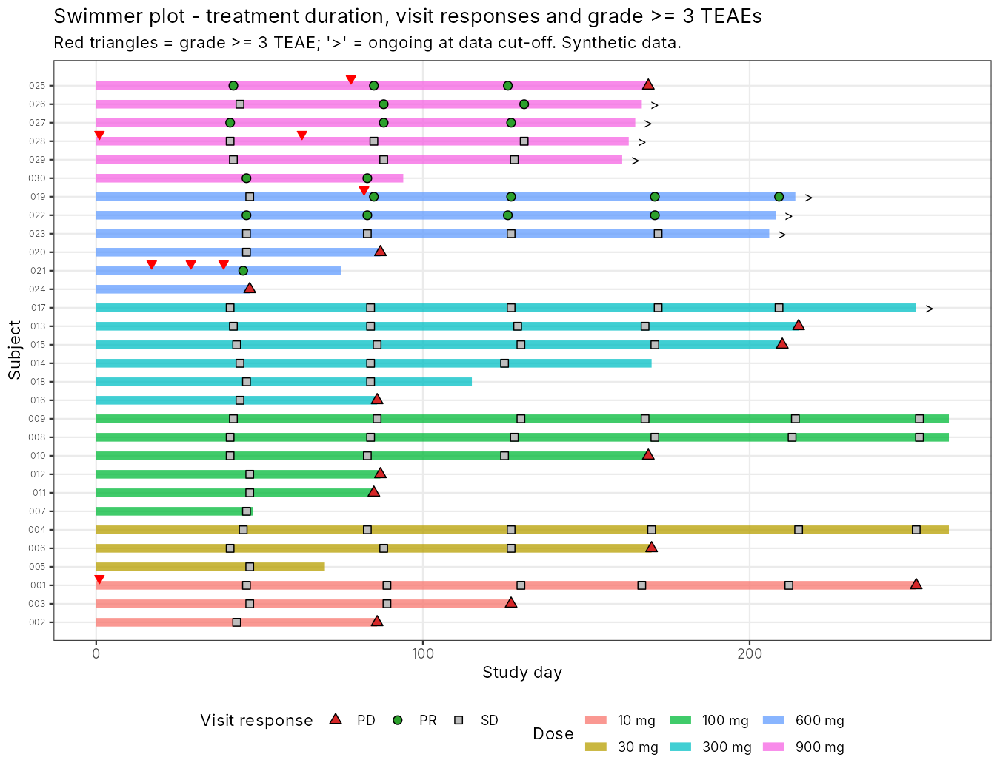
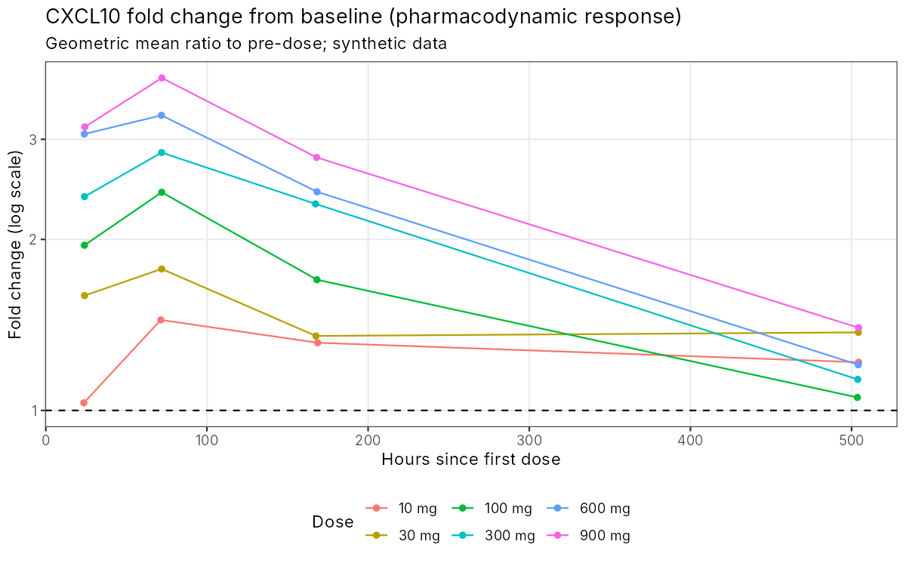

# ROC-FIH-SYN-001 - Exploratory Early-Development Summary (SYNTHETIC DATA)

Data cut-off 2026-03-31. Generated 2026-11-24 by `run_pipeline.R`; every number below is computed from the ADaM datasets in `output/adam/`.

## Populations

- Enrolled/treated (SAFFL): **30**; PK-evaluable (PKFL): **30**; DLT-evaluable: **30**
- Ongoing at cut-off: **8**; discontinued: **19**; subjects with a DLT: **3**

## Demographics

| Dose | N | Age, median (range) | Male, n | ECOG 1, n |
|---|---|---|---|---|
| 10 mg | 3 | 61 (49-61) | 2 | 2 |
| 30 mg | 3 | 64 (58-72) | 1 | 0 |
| 100 mg | 6 | 57 (47-63) | 1 | 3 |
| 300 mg | 6 | 64 (49-79) | 2 | 3 |
| 600 mg | 6 | 56 (43-68) | 2 | 5 |
| 900 mg | 6 | 64 (54-82) | 3 | 4 |
| Total | 30 | 61 (43-82) | 11 | 17 |

## Safety - treatment-emergent adverse events (subjects, n)

| Dose | N | Any TEAE | Grade >= 3 | Related | Serious | CRS / IRR (AESI) | DLT |
|---|---|---|---|---|---|---|---|
| 10 mg | 3 | 2 | 1 | 1 | 1 | 1 | 1 |
| 30 mg | 3 | 2 | 0 | 1 | 0 | 1 | 0 |
| 100 mg | 6 | 5 | 0 | 4 | 0 | 3 | 0 |
| 300 mg | 6 | 5 | 0 | 5 | 0 | 4 | 0 |
| 600 mg | 6 | 6 | 2 | 4 | 2 | 3 | 1 |
| 900 mg | 6 | 6 | 2 | 6 | 1 | 4 | 1 |

## Pharmacokinetics - geometric mean (geometric CV%)

Units: Cmax ng/mL; AUCinf h*ng/mL; t1/2 h; CL L/h. NE = not estimable.

| Dose | CMAX | AUCIFO | THALF | CL |
|---|---|---|---|---|
| 10 mg | 2,790 (31%) | 219,998 (42%) |   51 (33%) | 0.0455 (42%) |
| 30 mg | 9,260 (20%) | 769,819 (33%) | 59.8 (51%) | 0.039 (33%) |
| 100 mg | 32,571 (32%) | 4,235,903 (33%) |  101 (68%) | 0.0236 (33%) |
| 300 mg | 102,577 (17%) | 22,588,960 (41%) |  173 (43%) | 0.0133 (41%) |
| 600 mg | 197,909 (14%) | 47,880,908 (30%) |  181 (58%) | 0.0125 (30%) |
| 900 mg | 272,504 (41%) | 107,509,755 (18%) |  231 (37%) | 0.00837 (18%) |

Dose proportionality (power model, 90% CI): Cmax slope 1.02 (0.96-1.07); AUCinf slope 1.38 (1.31-1.45).

## Best overall response (unconfirmed, target lesions only)

| Dose | N | PR | SD | PD | NE | ORR, % | DCR, % |
|---|---|---|---|---|---|---|---|
| 10 mg | 3 | 0 | 3 | 0 | 0 | 0 | 100 |
| 30 mg | 3 | 0 | 3 | 0 | 0 | 0 | 100 |
| 100 mg | 6 | 0 | 6 | 0 | 0 | 0 | 100 |
| 300 mg | 6 | 0 | 6 | 0 | 0 | 0 | 100 |
| 600 mg | 6 | 3 | 2 | 1 | 0 | 50 | 83 |
| 900 mg | 6 | 4 | 2 | 0 | 0 | 67 | 100 |

## Pharmacodynamic and exploratory biomarkers

| Dose | n | Peak CXCL10 fold change (geo mean) |
|---|---|---|
| 10 mg | 3 | 1.5 |
| 30 mg | 3 | 1.88 |
| 100 mg | 6 | 2.56 |
| 300 mg | 6 | 2.93 |
| 600 mg | 6 | 3.71 |
| 900 mg | 6 | 4.01 |

ctDNA was added by protocol amendment 1 (2025-09-01): **11 of 30** subjects have a ctDNA baseline; the others contribute post-amendment samples without a baseline and are excluded from change-from-baseline summaries.

## Quality control

Independent double programming (production vs QC):

| dataset | n_production | n_qc | variables_compared | value_differences | status |
|---|---|---|---|---|---|
| ADSL | 30 | 30 | 11 | 0 | MATCH |
| ADPP (NCA) | 202 | 202 | 1 | 0 | MATCH |
| ADRS | 30 | 30 | 5 | 0 | MATCH |

Data integrity checks: **62** run, **62** passed, **0** failed (see `output/qc/integrity_checks.csv`).

> All data are simulated. No real patient information is used and no clinical conclusions should be drawn.
